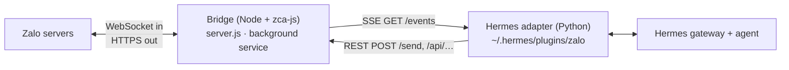

<p align="center">
  
</p>

# hermes-zalo-plugin

📖 **English** · [Tiếng Việt](./README.vi.md)

[](https://www.npmjs.com/package/hermes-zalo-plugin)
[](https://www.npmjs.com/package/hermes-zalo-plugin)
[](https://github.com/cuongdev/hermes-zalo-plugin/stargazers)
[](./LICENSE)

Chat with your **Hermes Agent** from a **personal Zalo account**: private chats
and groups, with images, files, voice, stickers and reactions. Works on macOS,
Linux and Windows.

> ⚠️ This uses [zca-js](https://www.npmjs.com/package/zca-js), an **unofficial**
> Zalo API. Zalo may rate-limit or lock accounts that automate. Use a secondary
> account.

## Quick start

**You need:** Node.js ≥ 18, Hermes Agent with `pip install aiohttp`, and the Zalo
app on your phone to scan a QR code.

**1. Get the code** and keep the folder where it is: the background service runs
the bridge from it.

```bash
git clone https://github.com/pdt590/chatbot-personal-zalo-hermes.git hermes-zalo-plugin
cd hermes-zalo-plugin
```

**2. Run the installer.** It installs the dependencies, shows a QR code to scan
with the Zalo app, registers the background service, and copies the adapter
into Hermes.

| macOS / Linux    | Windows (PowerShell) |
| ---------------- | -------------------- |
| `./install.sh` | `.\install.ps1`    |

On Windows, if PowerShell refuses to run the script, first run
`Set-ExecutionPolicy -Scope Process -ExecutionPolicy Bypass`.

**3. Connect it to Hermes:**

```bash
hermes gateway setup            # choose "Zalo": who may talk to the bot, permissions
hermes gateway                  # start chatting
```

The installer is safe to re-run. It skips the QR scan while the saved session
still works, and restarts the service so it loads new code. Options (the same
on both platforms, e.g. `./install.sh --relogin`):

| Flag                     | Effect                                                                                                                                                 |
| ------------------------ | ------------------------------------------------------------------------------------------------------------------------------------------------------ |
| `--relogin`            | Force a new QR scan. A running bridge is stopped first, then started again.                                                                            |
| `--service-only`       | Only (re)install the service and the adapter.                                                                                                          |
| `--no-service`         | Skip the service; run the bridge yourself with `node bin/cli.mjs start`.                                                                             |
| `--hermes-home <path>` | Install the adapter into this Hermes profile. Same as setting `HERMES_HOME`. If you pass neither, `~/.hermes` is used only when it already exists. |

## How it works



The package has two halves:

| Part                                                | Where it runs                                                                                           | Job                                                                                                                                                                                                                                     |
| --------------------------------------------------- | ------------------------------------------------------------------------------------------------------- | --------------------------------------------------------------------------------------------------------------------------------------------------------------------------------------------------------------------------------------- |
| **Bridge** (`server.js`, `zaloClient.js`) | Background service: systemd user unit (Linux), launchd agent (macOS), Scheduled Task at logon (Windows) | Holds the Zalo session and keeps it alive (keepalive, automatic cookie re-login). Pushes inbound events over SSE (15 s heartbeat, `Last-Event-ID` replay). Exposes REST routes for all 154 zca-js methods, gated by an action policy. |
| **Adapter** (`hermes-plugin/`)              | Inside `hermes gateway`, as plugin `zalo-platform`                                                  | Turns SSE events into Hermes messages and downloads inbound media. Decides which chats the bot answers. Sends replies through the bridge.                                                                                               |

Data lives in `~/.hermes-zalo/` (`ZALO_DATA_DIR` overrides it): `credentials.json`,
`bridge.env`, `qr.png`, the undo cache `climsgids/`, and logs on macOS/Windows.
Updating or reinstalling leaves it alone.

## Commands

Run these from the plugin folder as `node bin/cli.mjs <command>`:

| Command             | What it does                                                                            |
| ------------------- | --------------------------------------------------------------------------------------- |
| `status`          | Show the service state, bridge health, logged-in account and data paths.                |
| `login [--force]` | QR login. A running bridge that was logged out picks up the new session by itself.      |
| `restart`         | Restart the service, or start it if it is stopped. Run it after editing `bridge.env`. |
| `stop`            | Stop the service. It stays installed.                                                   |
| `start`           | Run the bridge in the foreground (Ctrl-C stops it).                                     |

Installing and removing use the scripts: `install.sh` / `install.ps1` and
`uninstall.sh` / `uninstall.ps1`. Messages printed by the tools and the Hermes
wizard say `hermes-zalo-plugin <command>`; in a source install that is
`node bin/cli.mjs <command>`.

## Using it

<p align="center">
  
</p>

- **Private chat:** message the bot's Zalo account. The agent replies.
- **Groups:** by default the bot answers only when it is @mentioned, when someone
  replies to one of its messages, or when a message starts with its display name
  (`ZALO_GROUP_MODE=mention`). If you picked no group in the wizard, the bot stays
  out of all groups.
- **Group stats and summaries:** the plugin adds the `zalo_groups` toolset with
  two agent tools: `zalo_group_stats` (every group with member count and recent
  activity) and `zalo_group_messages` (a group's recent messages, including ones
  that did not address the bot, for summaries). Enable it for Zalo by adding
  `zalo_groups` under `platform_toolsets.zalo` in the profile's `config.yaml`.
  The bridge keeps its own log of group messages (`ZALO_GROUP_LOG_DAYS`), so only
  messages received while it was running are available.
- **Finding IDs:** set `ZALO_LOG_IDS=true`, send a message, then read the
  `uid=… threadId=…` line in the gateway log.
- **Changing settings:** re-run `hermes gateway setup`. It searches your contacts
  by name, so you never type raw IDs.

### Message formatting

The agent writes Markdown and the bridge turns it into Zalo text styles:

| You write                                                                  | Zalo shows                                 |
| -------------------------------------------------------------------------- | ------------------------------------------ |
| `**bold**` or `__bold__`                                                   | bold                                       |
| `*italic*` or `_italic_`                                                   | italic                                     |
| `***bold italic***`                                                        | bold + italic                              |
| `~~strike~~`                                                               | strikethrough                              |
| `` `code` ``                                                               | bold (Zalo has no monospace font)          |
| `# Heading` (any level) at the start of a line                             | bold + large                               |
| `> quote`                                                                  | italic                                     |
| `1. item` or `1) item`                                                     | the number in bold + large                 |
| `- item` or `* item`, indented sub-items                                   | `- item`, sub-items become `• item`        |
| `[label](https://…)`                                                       | **label** (https://…)                      |
| `[red]…[/red]` · `[orange]…[/orange]` · `[yellow]…[/yellow]` · `[green]…[/green]` | colored text                        |

Color tags ignore case and have Vietnamese aliases: `[do]` (red), `[cam]`
(orange), `[vang]` (yellow), `[xanh]` (green). Other styles work inside them, e.g.
`[red]Total: **500.000đ**[/red]`.

Styles can be nested, e.g. `*italic with **bold** inside*`. A marker must touch
the words it wraps, so `2 * 3`, `a ** b **`, `snake_case` and `my__var__x` stay
as they are. Styles never cross a line break. In a ` ``` ` block the fences
are removed and the content is sent as typed. `---` rules are dropped and runs
of blank lines collapse into one. Zalo has no tables, so they arrive as plain
text. Long replies are split into several messages, each within Zalo's limits
(2000 characters, 40 styles, about 3000 bytes), preferring a paragraph or line
break as the cut. A message that carries @mentions is sent as one message, and
its text is left unconverted when formatting would shift the mention positions.

## Configuration

Settings live in two places, because the bridge and the adapter are separate
processes. `hermes gateway setup` writes both and offers to restart the bridge.

**Adapter:** the Hermes profile's `.env`. Restart `hermes gateway` after editing it.

| Var                      | Default            | Meaning                                                                                                                                   |
| ------------------------ | ------------------ | ----------------------------------------------------------------------------------------------------------------------------------------- |
| `ZALO_PLUGIN_URL`      | must be set        | Bridge address, e.g. `http://127.0.0.1:8787`. The adapter stays disabled until this is set.                                             |
| `ZALO_PLUGIN_TOKEN`    | —                 | Must match the bridge's token, if the bridge has one.                                                                                     |
| `ZALO_ALLOWED_USERS`   | empty              | Comma-separated sender uids allowed to use the bot. Empty means everyone, which also needs `ZALO_ALLOW_ALL_USERS=true`.                 |
| `ZALO_ALLOW_ALL_USERS` | `false`          | Read by the Hermes gateway: `true` lets anyone talk to the bot. Without it, or an allowlist, Hermes asks unknown senders to pair first. |
| `ZALO_ALLOWED_THREADS` | empty, meaning all | Comma-separated group or chat IDs the bot works in                                                                                        |
| `ZALO_GROUP_MODE`      | `mention`        | `mention` · `all` · `off`                                                                                                         |
| `ZALO_GROUP_TRIGGERS` | empty            | Extra comma-separated words that address the bot in groups when a message starts with them (e.g. `bot,hermes`), besides its display name |
| `ZALO_REPLY_QUOTE`     | `group`          | Whether the bot's answer quotes the message it replies to: `group` (groups only) · `all` · `off` |
| `ZALO_HOME_CHANNEL`    | —                 | Where cron jobs deliver: `<uid>` or `group:<id>`                                                                                      |
| `ZALO_LOG_IDS`         | `false`          | Log the uid and threadId of every inbound message                                                                                         |

**Bridge:** `~/.hermes-zalo/bridge.env` (`KEY=VALUE` lines). Real environment
variables take precedence. Run `node bin/cli.mjs restart` after editing it.

| Var                                                     | Default                  | Meaning                                                                                                                            |
| ------------------------------------------------------- | ------------------------ | ---------------------------------------------------------------------------------------------------------------------------------- |
| `ZALO_PLUGIN_PORT` / `ZALO_PLUGIN_HOST`             | `8787` / `127.0.0.1` | Listen address. Keep it on loopback.                                                                                               |
| `ZALO_PLUGIN_TOKEN`                                   | —                       | Shared secret required on every route except `/health`                                                                           |
| `ZALO_ALLOWED_ACTION_GROUPS`                          | `read,send,interact`   | Allowed action groups, from least to most dangerous: `read` < `send` < `interact` < `manage` < `destructive`, or `all` |
| `ZALO_ALLOW_DESTRUCTIVE`                              | `false`                | Must be `true` before any `destructive` action runs, even with `all`                                                         |
| `ZALO_ALLOWED_ACTIONS` / `ZALO_DENIED_ACTIONS`      | —                       | Method names to always allow or always block. The deny list wins over everything.                                                  |
| `ZALO_CLIMSG_RETENTION_DAYS`                          | `30`                   | Days of undo cache to keep on disk. `0` keeps it in memory only.                                                                 |
| `ZALO_GROUP_LOG_DAYS`                                 | `3`                    | Days of group messages the bridge keeps for group stats and summaries. `0` keeps the last day in memory only. |
| `ZALO_INFO_CACHE_TTL` / `ZALO_INFO_MIN_INTERVAL_MS` | `600` s / `1500` ms  | Cache and throttle for info lookups, to avoid account locks                                                                        |
| `ZALO_SELF_LISTEN`                                    | off                      | Also emit your own outgoing messages                                                                                               |

`GET /policy` shows the policy in effect. The full action map is in
[permissions.js](./permissions.js).

## Security

- **One session per account.** Logging in to the same account on Zalo Web, or
  starting a second bridge, ends this session (code 3000). Keep the phone app;
  close other web sessions.
- **Session secrets stay inside.** `getCookie` and `getContext` are blocked in
  every group, even `all`; they run only when listed in `ZALO_ALLOWED_ACTIONS`.
  The send routes refuse files inside the data directory, so the agent cannot
  post `credentials.json` to a chat.
- **Destructive actions are off** (dispersing groups, deleting messages, blocking
  users) until you set `ZALO_ALLOW_DESTRUCTIVE=true`. Anyone allowed to talk to
  the bot can ask the agent to use what the policy permits.
- **Keep the bridge on `127.0.0.1`.** Set `ZALO_PLUGIN_TOKEN` if other local
  users or programs could reach the port. `credentials.json` and `bridge.env`
  are as sensitive as a password.

### Tool access hook (optional)

The bridge policy limits what the agent can do *on Zalo*. It does not stop a
Zalo user from asking the agent to run a shell command or read your files.
[hooks/zalo-tool-access.py](./hooks/zalo-tool-access.py) is a Hermes
`pre_tool_call` hook that closes that gap for one profile:

| Who is asking                         | Result                                                                    |
| ------------------------------------- | ------------------------------------------------------------------------- |
| Not Zalo (CLI, TUI, desktop, cron)    | Allowed, under the normal Hermes policy                                   |
| Zalo, not an owner                    | Every tool blocked                                                        |
| Zalo, owner                           | Only read-only tools; reading secret paths (`~/.hermes`, `~/.ssh`, `.env`…) is blocked |
| Sender cannot be determined, or any error | Blocked (fail closed)                                                 |

The sender comes from the profile's `state.db` (`sessions.source`, `sessions.user_id`),
looked up by the payload's `session_id`. If the session is not there, the hook falls
back to `HERMES_SESSION_PLATFORM` and `HERMES_SESSION_USER_ID`.

**1. Copy it into the profile.** `P` is the profile directory (`~/.hermes` for the default
profile, `~/.hermes/profiles/<name>` for a named one):

```bash
P=~/.hermes/profiles/<name>
mkdir -p "$P/agent-hooks" "$P/logs"
cp "$(npm root -g)/hermes-zalo-plugin/hooks/zalo-tool-access.py" "$P/agent-hooks/"
chmod 700 "$P/agent-hooks/zalo-tool-access.py"
```

**2. Register it** in `$P/config.yaml`. Put the settings on the command line.
Hermes runs the hook without a shell, so you cannot set variables inline
(`FOO=1 script`):

```yaml
hooks:
  pre_tool_call:
    - command: "/home/<you>/.hermes/profiles/<name>/agent-hooks/zalo-tool-access.py --owner 5502067660612252304"
      timeout: 10
      fail_closed: true
```

Settings. A command-line argument wins over the env var, and the env var wins over the default:

| Argument | Env var | Default | Meaning |
| --- | --- | --- | --- |
| `--owner ID[,ID]` | `ZALO_HOOK_OWNERS` | none | Zalo uids treated as owner. With none, every Zalo user is blocked. Use the uid from `allow_admin_from` / `ZALO_ALLOWED_USERS`; `ZALO_LOG_IDS=true` logs it. |
| `--profile-home PATH` | `ZALO_HOOK_PROFILE_HOME` | parent of the script's folder | Profile whose `state.db` is read. Set it if the script is not in `<profile>/agent-hooks/`. |
| `--owner-tools a,b` | `ZALO_HOOK_OWNER_TOOLS` | `read_file, search_files, vision_analyze, todo_list, tool_search, tool_describe, clarify, zalo_group_stats, zalo_group_messages` | Replaces the list of tools an owner may use on Zalo |
| `--extra-tools a,b` | `ZALO_HOOK_EXTRA_TOOLS` | — | Adds tools to that list, e.g. `web_search` |
| `--secret-paths p,q` | `ZALO_HOOK_SECRET_PATHS` | — | More directories an owner may not read, relative to `~` or absolute |
| `--log PATH` | `ZALO_HOOK_LOG` | `<profile>/logs/zalo-tool-access.log` | One `ALLOW` / `BLOCK` line per tool call |

`--owner`, `--extra-tools` and `--secret-paths` can be repeated. Env vars work only if the
Hermes gateway process has them. Arguments in `config.yaml` are the reliable place.

**3. Approve it.** Hermes skips a hook that is not in `$P/shell-hooks-allowlist.json` and logs
`not allowlisted — skipped`. Approve it once: run `hermes` for that profile and answer the
prompt, or start it once with `--accept-hooks` (or `HERMES_ACCEPT_HOOKS=1`). The approval is
tied to the exact `command` string, so changing the arguments needs a new approval.

**4. Restart and check:**

```bash
systemctl --user restart hermes-gateway.service
H="$P/agent-hooks/zalo-tool-access.py --owner <owner-uid>"
echo '{"tool_name":"terminal"}' | HERMES_SESSION_PLATFORM=zalo HERMES_SESSION_USER_ID=<owner-uid> $H  # block: not read-only
echo '{"tool_name":"terminal"}' | HERMES_SESSION_PLATFORM=zalo HERMES_SESSION_USER_ID=123 $H          # block: not owner
echo '{"tool_name":"terminal"}' | HERMES_SESSION_PLATFORM=cli $H                                     # no output: allowed
tail "$P/logs/zalo-tool-access.log"
```

When the plugin gains a new read-only tool, add it with `--extra-tools`. Until you do, owners are
blocked from it too. The script can be edited without approving it again, so keep it writable
only by you.

## HTTP API (bridge)

With a token set, send it as the `x-bridge-token` header, `Authorization: Bearer <token>`, or `?token=` (handy for opening `/qr.png` in a browser).

| Route                                                                                                 | Purpose                                                                                                                                       |
| ----------------------------------------------------------------------------------------------------- | --------------------------------------------------------------------------------------------------------------------------------------------- |
| `GET /health`                                                                                       | `{ loggedIn, sessionDead, ownId, ownName, … }`. No token needed.                                                                           |
| `GET /events`                                                                                       | SSE stream: `message`, `reaction`, `undo`, `status`, `session_dead`, `friend_event`, `group_event`                              |
| `POST /send`                                                                                        | `{ threadId, threadType: "user"\|"group", text, mentions?, quote?, styles? }`. Markdown in `text` is converted unless you pass `styles`. |
| `POST /send-attachment` · `/send-voice` · `/send-sticker` · `/send-card`                   | Media. Local paths only; files in the data directory are refused.                                                                             |
| `POST /react` · `/undo` · `/typing`                                                           | Reactions, recalling a message, typing indicator                                                                                              |
| `GET /contacts` · `/friends` · `/groups` · `/chat-info` · `/stickers` · `/find-user` | Lookups                                                                                                                                       |
| `GET /group-stats?hours=` · `/group-messages?groupId=&hours=&limit=`                                 | Group activity and logged group messages                                                                                                      |
| `POST /group/*` · `/friend/*` · `/poll/create`                                                | Group, friend and poll management                                                                                                             |
| `POST /api/<method>`                                                                                | `{ args: [...] }` calls any zca-js method, subject to the policy                                                                            |
| `GET /qr` · `/qr.png` · `POST /relogin` · `GET /policy` · `POST /shutdown`              | Session and admin                                                                                                                             |

## Updating

From the plugin folder:

```bash
git pull
npm install                     # pick up dependency changes
./install.sh --service-only     # Windows: .\install.ps1 --service-only
hermes gateway restart          # load the new adapter
```

`--service-only` restarts the bridge on the new code and refreshes the adapter.
Add `--hermes-home <path>` if you installed the adapter into a non-default
profile. Your login and settings in `~/.hermes-zalo/` are kept.

## Uninstalling

| macOS / Linux      | Windows (PowerShell) |
| ------------------ | -------------------- |
| `./uninstall.sh` | `.\uninstall.ps1`  |

This stops and removes the background service and removes the adapter from
Hermes (`zalo-platform` is dropped from `plugins.enabled`). Your Zalo login is
kept, so reinstalling needs no QR scan.

| Flag                     | Effect                                                                |
| ------------------------ | --------------------------------------------------------------------- |
| `--purge`              | Also delete the saved Zalo login (`credentials.json`).              |
| `--hermes-home <path>` | Remove the adapter from this Hermes profile instead of `~/.hermes`. |

Afterwards you can delete the plugin folder, and `~/.hermes-zalo/` to drop
`bridge.env`, the undo cache and logs as well. Restart `hermes gateway` so it
stops loading the adapter.

## Troubleshooting

| Symptom                                                | Fix                                                                                                            |
| ------------------------------------------------------ | -------------------------------------------------------------------------------------------------------------- |
| `status` shows `loggedIn=false` or `sessionDead` | `node bin/cli.mjs login`. If the saved cookie is dead: `./install.sh --relogin`.                           |
| Session keeps dying with code 3000                     | The account was opened on Zalo Web or by another bridge. Close that session, then `login`.                   |
| `Bridge: NOT running`                                | `node bin/cli.mjs restart`. If the service was never installed: `./install.sh --service-only`.             |
| Service fails to start after a Node upgrade            | It was installed by an older version that pinned a versioned Node path. Run `./install.sh --service-only`.   |
| Bridge stops after the folder was moved                | The service runs the bridge from the folder it was installed from. Run the installer again from the new place. |
| Gateway replies "I don't recognize you"                | `ZALO_ALLOWED_USERS` is empty but `ZALO_ALLOW_ALL_USERS` is not `true`. Re-run `hermes gateway setup`. |
| Bot ignores a group                                    | You didn't @mention it, the group isn't in `ZALO_ALLOWED_THREADS`, or `ZALO_GROUP_MODE=off`.               |
| An action returns HTTP 403                             | The policy blocks it. Widen it in `bridge.env`, then `restart`.                                            |
| HTTP 401 from the bridge                               | The adapter's `ZALO_PLUGIN_TOKEN` differs from the one in `bridge.env`.                                    |
| Settings have no effect                                | Bridge keys must be in `bridge.env`, not in the Hermes `.env`. Then `restart`.                           |
| Logs                                                   | Linux: `journalctl --user -u com.hermes.zaloplugin -f`. macOS/Windows: `~/.hermes-zalo/bridge.*.log`.      |
| Bridge stopped on Windows                              | The Scheduled Task starts it at logon but not after a crash. Run `restart`.                                  |
| Service won't start over SSH (Linux)                   | `loginctl enable-linger $USER`, log in again, then `restart`.                                              |

## Development

```bash
npm install
npm test                                             # Node unit tests
python -m unittest discover -s test -p "test_*.py"   # adapter tests
ZALO_DATA_DIR=./data node login.mjs && npm start     # isolated local run
```

The local run opens its own Zalo session. With the same account as your
service, stop the service first (`node bin/cli.mjs stop`), or the two will
kick each other off.

To release: run `npm test`, then `npm version patch|minor|major`,
`npm publish`, and `git push --follow-tags`. There is no CI; publishing is manual.

## License

MIT © [Cường Tuấn Nguyễn](https://github.com/cuongdev) · If this helped, a ⭐ helps others find it.
