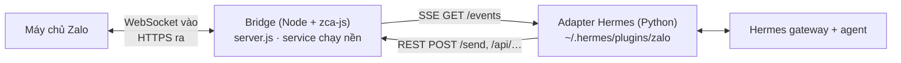

<p align="center">
  
</p>

# hermes-zalo-plugin

[English](./README.md) · 📖 **Tiếng Việt**

[](https://www.npmjs.com/package/hermes-zalo-plugin)
[](https://www.npmjs.com/package/hermes-zalo-plugin)
[](https://github.com/cuongdev/hermes-zalo-plugin/stargazers)
[](./LICENSE)

Chat với **Hermes Agent** của bạn từ một **tài khoản Zalo cá nhân**: chat riêng
và nhóm, có ảnh, file, tin nhắn thoại, sticker và thả cảm xúc. Chạy được trên
macOS, Linux và Windows.

> ⚠️ Plugin dùng [zca-js](https://www.npmjs.com/package/zca-js), một API Zalo
> **không chính thức**. Zalo có thể giới hạn hoặc khoá tài khoản chạy tự động.
> Hãy dùng tài khoản phụ.

## Bắt đầu nhanh

**Cần có:** Node.js ≥ 18, Hermes Agent đã chạy `pip install aiohttp`, và app Zalo
trên điện thoại để quét mã QR.

<p align="center">
  
</p>

**1. Tải mã nguồn** và giữ nguyên thư mục ở chỗ đó: service chạy nền sẽ chạy
bridge từ chính thư mục này.

```bash
git clone https://github.com/cuongdev/hermes-zalo-plugin.git
cd hermes-zalo-plugin
```

**2. Chạy file cài đặt.** Trình cài đặt sẽ cài các thư viện cần thiết, hiện mã
QR để quét bằng app Zalo, đăng ký service chạy nền, và chép adapter vào Hermes.

| macOS / Linux | Windows (PowerShell) |
|---|---|
| `./install.sh` | `.\install.ps1` |

Trên Windows, nếu PowerShell không cho chạy script, hãy chạy trước lệnh
`Set-ExecutionPolicy -Scope Process -ExecutionPolicy Bypass`.

**3. Kết nối với Hermes:**

```bash
hermes gateway setup            # chọn "Zalo": ai được dùng bot, cấp quyền
hermes gateway                  # bắt đầu chat
```

Chạy lại trình cài đặt nhiều lần vẫn an toàn. Khi phiên đăng nhập đã lưu còn
dùng được thì không phải quét QR lại, và service được khởi động lại để chạy code
mới. Các tuỳ chọn (giống nhau trên mọi hệ điều hành, ví dụ `./install.sh --relogin`):

| Cờ | Tác dụng |
|---|---|
| `--relogin` | Bắt buộc quét QR mới. Bridge đang chạy sẽ được dừng trước rồi bật lại. |
| `--service-only` | Chỉ cài (lại) service và adapter. |
| `--no-service` | Không cài service; tự chạy bridge bằng `node bin/cli.mjs start`. |
| `--hermes-home <path>` | Cài adapter vào profile Hermes này. Tương đương đặt `HERMES_HOME`. Nếu không chỉ định, chỉ dùng `~/.hermes` khi thư mục đó đã có sẵn. |

## Cách hoạt động



Package gồm hai phần:

| Phần | Chạy ở đâu | Nhiệm vụ |
|---|---|---|
| **Bridge** (`server.js`, `zaloClient.js`) | Service chạy nền: systemd user unit (Linux), launchd agent (macOS), Scheduled Task khi đăng nhập Windows | Giữ phiên Zalo luôn sống (keepalive, tự đăng nhập lại bằng cookie). Đẩy sự kiện đến qua SSE (heartbeat 15 giây, phát lại theo `Last-Event-ID`). Mở REST route cho cả 145 hàm của zca-js, có kiểm soát quyền. |
| **Adapter** (`hermes-plugin/`) | Bên trong `hermes gateway`, là plugin `zalo-platform` | Chuyển sự kiện SSE thành tin nhắn Hermes và tải media đến. Quyết định bot trả lời ở cuộc chat nào. Gửi câu trả lời qua bridge. |

Dữ liệu nằm ở `~/.hermes-zalo/` (đổi bằng `ZALO_DATA_DIR`): `credentials.json`,
`bridge.env`, `qr.png`, cache thu hồi tin `climsgids/`, và log trên macOS/Windows.
Cập nhật hay cài lại đều không đụng tới thư mục này.

## Các lệnh

Chạy trong thư mục plugin theo dạng `node bin/cli.mjs <lệnh>`:

| Lệnh | Tác dụng |
|---|---|
| `status` | Xem trạng thái service, tình trạng bridge, tài khoản đang đăng nhập và đường dẫn dữ liệu. |
| `login [--force]` | Đăng nhập bằng QR. Bridge đang chạy mà bị đăng xuất sẽ tự nhận phiên mới. |
| `restart` | Khởi động lại service, hoặc bật lên nếu đang tắt. Chạy lệnh này sau khi sửa `bridge.env`. |
| `stop` | Dừng service. Service vẫn được giữ nguyên cài đặt. |
| `start` | Chạy bridge ở foreground (Ctrl-C để dừng). |

Cài đặt và gỡ cài đặt dùng các file script: `install.sh` / `install.ps1` và
`uninstall.sh` / `uninstall.ps1`. Thông báo của công cụ và của wizard Hermes ghi
`hermes-zalo-plugin <lệnh>`; khi cài từ mã nguồn, lệnh tương ứng là
`node bin/cli.mjs <lệnh>`.

## Sử dụng

<p align="center">
  
</p>

- **Chat riêng:** nhắn tin tới tài khoản Zalo của bot, agent sẽ trả lời.
- **Nhóm:** mặc định bot chỉ trả lời khi được @nhắc, khi có người trả lời tin
  của bot, hoặc khi tin nhắn bắt đầu bằng tên hiển thị của bot
  (`ZALO_GROUP_MODE=mention`). Nếu không chọn nhóm nào trong wizard, bot sẽ không
  hoạt động ở nhóm nào.
- **Tìm ID:** đặt `ZALO_LOG_IDS=true`, gửi một tin nhắn, rồi đọc dòng
  `uid=… threadId=…` trong log của gateway.
- **Đổi cấu hình:** chạy lại `hermes gateway setup`. Wizard cho tìm danh bạ theo
  tên, nên bạn không cần gõ ID.

### Định dạng tin nhắn

Agent viết Markdown, bridge chuyển sang kiểu chữ của Zalo:

| Bạn viết | Zalo hiển thị |
|---|---|
| `**đậm**` · `*nghiêng*` · `__gạch chân__` · `~~gạch ngang~~` | đậm · nghiêng · gạch chân · gạch ngang |
| `# Tiêu đề` ở đầu dòng | chữ lớn |
| `{red:chữ}` · `{orange:…}` · `{yellow:…}` · `{green:…}` | chữ màu |

Ký hiệu phải dính liền với chữ được bọc, nên gạch đầu dòng `* mục` và phép tính
`2 * 3` được giữ nguyên. Định dạng không kéo qua dòng mới. Chữ trong `` `code` ``
hoặc khối ```` ``` ```` giữ nguyên. Zalo không có bảng, link hay khối code, nên
những phần đó hiện dạng chữ thường. Câu trả lời dài hơn khoảng 4000 ký tự sẽ
được tách thành nhiều tin.

## Cấu hình

Cấu hình nằm ở hai nơi, vì bridge và adapter là hai tiến trình riêng.
`hermes gateway setup` ghi cả hai nơi và đề nghị khởi động lại bridge.

**Adapter:** file `.env` của profile Hermes. Sửa xong thì khởi động lại `hermes gateway`.

| Biến | Mặc định | Ý nghĩa |
|---|---|---|
| `ZALO_PLUGIN_URL` | bắt buộc | Địa chỉ bridge, ví dụ `http://127.0.0.1:8787`. Chưa đặt biến này thì adapter không chạy. |
| `ZALO_PLUGIN_TOKEN` | — | Phải trùng với token của bridge, nếu bridge có đặt token. |
| `ZALO_ALLOWED_USERS` | trống | Danh sách uid người gửi được dùng bot, cách nhau bằng dấu phẩy. Để trống là cho mọi người, khi đó cần thêm `ZALO_ALLOW_ALL_USERS=true`. |
| `ZALO_ALLOW_ALL_USERS` | `false` | Hermes gateway đọc biến này: `true` thì ai cũng nói chuyện được với bot. Không có biến này (hoặc danh sách cho phép), Hermes sẽ yêu cầu người lạ ghép cặp (pairing) trước. |
| `ZALO_ALLOWED_THREADS` | trống, tức là tất cả | ID nhóm hoặc cuộc chat mà bot hoạt động, cách nhau bằng dấu phẩy |
| `ZALO_GROUP_MODE` | `mention` | `mention` · `all` · `off` |
| `ZALO_HOME_CHANNEL` | — | Nơi nhận tin từ cron: `<uid>` hoặc `group:<id>` |
| `ZALO_LOG_IDS` | `false` | Ghi uid và threadId của mọi tin nhắn đến vào log |

**Bridge:** `~/.hermes-zalo/bridge.env` (mỗi dòng `KEY=VALUE`). Biến môi trường
thật được ưu tiên hơn file. Sửa xong thì chạy `node bin/cli.mjs restart`.

| Biến | Mặc định | Ý nghĩa |
|---|---|---|
| `ZALO_PLUGIN_PORT` / `ZALO_PLUGIN_HOST` | `8787` / `127.0.0.1` | Địa chỉ lắng nghe. Nên để ở loopback. |
| `ZALO_PLUGIN_TOKEN` | — | Mã bí mật, bắt buộc ở mọi route trừ `/health` |
| `ZALO_ALLOWED_ACTION_GROUPS` | `read,send,interact` | Các nhóm hành động được phép, từ ít đến nhiều rủi ro: `read` < `send` < `interact` < `manage` < `destructive`, hoặc `all` |
| `ZALO_ALLOW_DESTRUCTIVE` | `false` | Phải là `true` thì hành động `destructive` mới chạy, kể cả khi đã chọn `all` |
| `ZALO_ALLOWED_ACTIONS` / `ZALO_DENIED_ACTIONS` | — | Tên hàm luôn được phép hoặc luôn bị chặn. Danh sách chặn có ưu tiên cao nhất. |
| `ZALO_CLIMSG_RETENTION_DAYS` | `30` | Số ngày giữ cache thu hồi tin trên đĩa. `0` thì chỉ giữ trong bộ nhớ. |
| `ZALO_INFO_CACHE_TTL` / `ZALO_INFO_MIN_INTERVAL_MS` | `600` giây / `1500` ms | Cache và giãn cách cho các lệnh tra cứu thông tin, tránh bị khoá tài khoản |
| `ZALO_SELF_LISTEN` | tắt | Phát cả tin nhắn do chính tài khoản gửi đi |

`GET /policy` cho xem chính sách quyền đang áp dụng. Danh sách phân nhóm đầy đủ
nằm trong [permissions.js](./permissions.js).

## Bảo mật

- **Mỗi tài khoản chỉ một phiên.** Đăng nhập cùng tài khoản trên Zalo Web, hoặc
  chạy bridge thứ hai, sẽ làm phiên này bị ngắt (mã 3000). App trên điện thoại
  thì không sao; hãy đóng các phiên web khác.
- **Bí mật phiên không lọt ra ngoài.** `getCookie` và `getContext` bị chặn ở mọi
  nhóm, kể cả `all`; chỉ chạy khi được liệt kê trong `ZALO_ALLOWED_ACTIONS`. Các
  route gửi file từ chối file trong thư mục dữ liệu, nên agent không thể gửi
  `credentials.json` vào một cuộc chat.
- **Hành động phá huỷ mặc định tắt** (giải tán nhóm, xoá tin, chặn người dùng)
  cho tới khi đặt `ZALO_ALLOW_DESTRUCTIVE=true`. Ai được phép nói chuyện với bot
  đều có thể nhờ agent làm những gì chính sách cho phép.
- **Giữ bridge ở `127.0.0.1`.** Đặt `ZALO_PLUGIN_TOKEN` nếu người dùng hay chương
  trình khác trên máy có thể truy cập cổng này. `credentials.json` và `bridge.env`
  nhạy cảm như mật khẩu.

## HTTP API (bridge)

Khi có token, gửi kèm qua header `x-bridge-token`, `Authorization: Bearer <token>`,
hoặc `?token=` (tiện khi mở `/qr.png` trên trình duyệt).

| Route | Mục đích |
|---|---|
| `GET /health` | `{ loggedIn, sessionDead, ownId, ownName, … }`. Không cần token. |
| `GET /events` | Luồng SSE: `message`, `reaction`, `undo`, `status`, `session_dead`, `friend_event`, `group_event` |
| `POST /send` | `{ threadId, threadType: "user"\|"group", text, mentions?, quote?, styles? }`. Markdown trong `text` được chuyển đổi, trừ khi bạn tự truyền `styles`. |
| `POST /send-attachment` · `/send-voice` · `/send-sticker` · `/send-card` | Gửi media. Chỉ nhận đường dẫn file cục bộ; file trong thư mục dữ liệu bị từ chối. |
| `POST /react` · `/undo` · `/typing` | Thả cảm xúc, thu hồi tin, báo đang gõ |
| `GET /contacts` · `/friends` · `/groups` · `/chat-info` · `/stickers` · `/find-user` | Tra cứu |
| `POST /group/*` · `/friend/*` · `/poll/create` | Quản lý nhóm, bạn bè, bình chọn |
| `POST /api/<method>` | `{ args: [...] }` gọi bất kỳ hàm nào của zca-js, theo chính sách quyền |
| `GET /qr` · `/qr.png` · `POST /relogin` · `GET /policy` · `POST /shutdown` | Phiên đăng nhập và quản trị |

## Cập nhật

Trong thư mục plugin:

```bash
git pull
npm install                     # cập nhật thư viện nếu có thay đổi
./install.sh --service-only     # Windows: .\install.ps1 --service-only
hermes gateway restart          # nạp adapter mới
```

`--service-only` khởi động lại bridge với code mới và cập nhật adapter. Thêm
`--hermes-home <path>` nếu bạn cài adapter vào profile khác mặc định. Phiên đăng
nhập và cấu hình trong `~/.hermes-zalo/` được giữ nguyên.

## Gỡ cài đặt

| macOS / Linux | Windows (PowerShell) |
|---|---|
| `./uninstall.sh` | `.\uninstall.ps1` |

Lệnh này dừng và gỡ service chạy nền, đồng thời gỡ adapter khỏi Hermes (bỏ
`zalo-platform` khỏi `plugins.enabled`). Phiên đăng nhập Zalo được giữ lại, nên
cài lại không cần quét QR.

| Cờ | Tác dụng |
|---|---|
| `--purge` | Xoá luôn phiên đăng nhập Zalo đã lưu (`credentials.json`). |
| `--hermes-home <path>` | Gỡ adapter khỏi profile Hermes này thay vì `~/.hermes`. |

Sau đó bạn có thể xoá thư mục plugin, và xoá `~/.hermes-zalo/` nếu muốn bỏ luôn
`bridge.env`, cache thu hồi tin và log. Khởi động lại `hermes gateway` để nó
thôi nạp adapter.

## Xử lý sự cố

| Triệu chứng | Cách xử lý |
|---|---|
| `status` báo `loggedIn=false` hoặc `sessionDead` | `node bin/cli.mjs login`. Nếu cookie đã hỏng: `./install.sh --relogin`. |
| Phiên liên tục bị ngắt với mã 3000 | Tài khoản đang được mở trên Zalo Web hoặc ở bridge khác. Đóng phiên đó, rồi `login`. |
| `Bridge: NOT running` | `node bin/cli.mjs restart`. Nếu chưa từng cài service: `./install.sh --service-only`. |
| Service không chạy sau khi nâng cấp Node | Service được cài bởi bản cũ, có ghi cứng đường dẫn Node kèm số phiên bản. Chạy `./install.sh --service-only`. |
| Bridge ngừng chạy sau khi chuyển thư mục | Service chạy bridge từ thư mục lúc cài. Chạy lại trình cài đặt ở chỗ mới. |
| Gateway trả lời "I don't recognize you" | `ZALO_ALLOWED_USERS` để trống nhưng `ZALO_ALLOW_ALL_USERS` chưa là `true`. Chạy lại `hermes gateway setup`. |
| Bot không trả lời trong nhóm | Chưa @nhắc bot, nhóm không có trong `ZALO_ALLOWED_THREADS`, hoặc `ZALO_GROUP_MODE=off`. |
| Một hành động trả về HTTP 403 | Chính sách quyền đang chặn. Mở rộng quyền trong `bridge.env`, rồi `restart`. |
| Bridge trả về HTTP 401 | `ZALO_PLUGIN_TOKEN` của adapter khác với token trong `bridge.env`. |
| Sửa cấu hình mà không có tác dụng | Biến của bridge phải nằm trong `bridge.env`, không phải `.env` của Hermes. Sau đó `restart`. |
| Xem log | Linux: `journalctl --user -u com.hermes.zaloplugin -f`. macOS/Windows: `~/.hermes-zalo/bridge.*.log`. |
| Bridge bị tắt trên Windows | Scheduled Task chỉ bật bridge khi đăng nhập Windows, không tự bật lại sau khi crash. Chạy `restart`. |
| Service không chạy khi vào qua SSH (Linux) | `loginctl enable-linger $USER`, đăng nhập lại, rồi `restart`. |

## Phát triển

```bash
npm install
npm test                                             # test Node
python -m unittest discover -s test -p "test_*.py"   # test adapter
ZALO_DATA_DIR=./data node login.mjs && npm start     # chạy thử với dữ liệu riêng
```

Bản chạy thử mở một phiên Zalo riêng. Nếu dùng chung tài khoản với service, hãy
dừng service trước (`node bin/cli.mjs stop`), nếu không hai bên sẽ ngắt phiên
của nhau.

Phát hành: chạy `npm version patch|minor|major`, rồi `git push --follow-tags`.
Tag `v*` kích hoạt `publish.yml`, workflow này publish kèm `--provenance` bằng
secret `NPM_TOKEN` của repo.

## Giấy phép

MIT © [Cường Tuấn Nguyễn](https://github.com/cuongdev) · Nếu thấy hữu ích, một ⭐ sẽ giúp người khác tìm thấy dự án.
