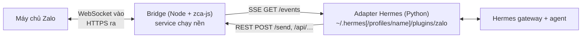

<p align="center">
  
</p>

# hermes-zalo-plugin

[English](./README.md) · 📖 **Tiếng Việt**

[](./LICENSE)

Chat với **Hermes Agent** từ một **tài khoản Zalo cá nhân**: chat riêng và nhóm,
hỗ trợ ảnh, file, tin nhắn thoại, sticker và thả cảm xúc. Chạy trên macOS, Linux
và Windows.

> ⚠️ Plugin dùng [zca-js](https://www.npmjs.com/package/zca-js), một API Zalo
> **không chính thức**. Zalo có thể giới hạn hoặc khoá tài khoản chạy tự động.
> Hãy dùng tài khoản phụ.

## Mục lục

1. [Bắt đầu nhanh](#bắt-đầu-nhanh)
2. [Cài đặt](#cài-đặt)
   - [Các cách chạy trình cài đặt](#các-cách-chạy-trình-cài-đặt)
   - [Trình cài đặt làm gì](#trình-cài-đặt-làm-gì)
   - [Chọn profile Hermes](#chọn-profile-hermes)
   - [Tuỳ chọn cài đặt](#tuỳ-chọn-cài-đặt)
   - [Biến môi trường trình cài đặt đọc](#biến-môi-trường-trình-cài-đặt-đọc)
   - [Ví dụ cài đặt](#ví-dụ-cài-đặt)
   - [Vị trí các thành phần đã cài](#vị-trí-các-thành-phần-đã-cài)
3. [Cập nhật](#cập-nhật)
4. [Gỡ cài đặt](#gỡ-cài-đặt)
5. [Cách hoạt động](#cách-hoạt-động)
6. [Lệnh CLI](#lệnh-cli)
7. [Sử dụng](#sử-dụng)
8. [Cấu hình](#cấu-hình)
9. [Bảo mật](#bảo-mật)
10. [HTTP API](#http-api)
11. [Xử lý sự cố](#xử-lý-sự-cố)
12. [Phát triển](#phát-triển)

## Bắt đầu nhanh

**Cần có:** Node.js ≥ 18, Hermes Agent (kèm `pip install aiohttp`), và app Zalo
trên điện thoại để quét mã QR.

```bash
# 1. Tải mã nguồn. Giữ nguyên thư mục: service chạy nền chạy từ đây.
git clone https://github.com/pdt590/chatbot-personal-zalo-hermes.git
cd chatbot-personal-zalo-hermes

# 2. Cài đặt: thư viện → đăng nhập QR → service chạy nền → adapter cho Hermes.
node bin/cli.mjs setup
# …hoặc cài vào các profile Hermes có tên (cách nhau bằng dấu phẩy):
node bin/cli.mjs setup --profile <name>

# 3. Kết nối với Hermes (thêm -p <name> nếu dùng profile có tên).
hermes gateway setup                 # chọn "Zalo": người dùng, nhóm, quyền
hermes gateway                       # bắt đầu chat
```

Phần còn lại giải thích từng tuỳ chọn. Nếu mặc định đã phù hợp thì bạn đã xong.

## Cài đặt

### Chạy trình cài đặt

Chạy từ bản git clone, trên mọi hệ điều hành: `node bin/cli.mjs setup [tuỳ chọn]`
(xem [tuỳ chọn](#tuỳ-chọn-cài-đặt) và các [lệnh CLI](#lệnh-cli) khác).

**Chạy lại an toàn:** thư viện chỉ cài khi còn thiếu, bước quét QR được bỏ qua khi
phiên đã lưu còn hiệu lực, service được đăng ký lại và khởi động lại với mã mới,
file adapter được ghi đè.

### Trình cài đặt làm gì

| Bước | Việc làm                                                                                                        | Bỏ qua khi             |
| ---- | --------------------------------------------------------------------------------------------------------------- | ---------------------- |
| 0    | Kiểm tra Node ≥ 18, xác định [profile Hermes](#chọn-profile-hermes).                                             | —                      |
| 1    | `npm install` nếu thiếu `node_modules/zca-js` (cần `npm` trong PATH).         | `--service-only`       |
| 2    | Đăng nhập Zalo bằng QR (dùng lại phiên đã lưu nếu còn chạy).                                                    | `--service-only`       |
| 3    | Đăng ký bridge thành service chạy nền: systemd user unit (Linux), launchd agent (macOS), Scheduled Task khi đăng nhập (Windows). | `--no-service` |
| 4    | Chép adapter Python vào `<profile>/plugins/zalo`, thêm `zalo-platform` vào `plugins.enabled` và toolset của plugin vào `platform_toolsets.zalo` trong `<profile>/config.yaml`. | không có profile mặc định |
| 5    | Tuỳ chọn [hook kiểm soát tool](#hook-kiểm-soát-tool-tuỳ-chọn): chép vào `<profile>/agent-hooks/`, đăng ký trong `hooks.pre_tool_call`, ghi cấu hình chủ bot vào `<profile>/.env`. | chỉ chạy khi có tuỳ chọn hook, hoặc hook đã được cài |

`<profile>` là thư mục của profile Hermes được chọn.

### Chọn profile Hermes

Hermes có thể chạy nhiều profile độc lập (`hermes profile list`). Adapter và hook
được cài vào các profile bạn chọn bằng **tên**; nhiều profile thì cách nhau bằng dấu
phẩy (`--profile default,work`). Trình cài đặt đổi tên thành
thư mục theo đúng cách `hermes -p <name>` làm:

| Tên profile | Thư mục (macOS / Linux)     | Thư mục (Windows)                        |
| ----------- | --------------------------- | ---------------------------------------- |
| `default`   | `~/.hermes`                 | `%LOCALAPPDATA%\hermes`                  |
| `<name>`    | `~/.hermes/profiles/<name>` | `%LOCALAPPDATA%\hermes\profiles\<name>`  |

Nơi cài được lấy từ nguồn đầu tiên có giá trị:

| # | Nguồn                            | Ví dụ                                    | Ghi chú                                                         |
| - | -------------------------------- | ---------------------------------------- | --------------------------------------------------------------- |
| 1 | `--profile <name>` / `-p <name>` | `--profile work`, `-p=work`              | Nên dùng.                                                       |
| 2 | `--hermes-home <path>`           | `--hermes-home /srv/hermes/work`         | Thư mục cụ thể. Không dùng chung với `--profile`.               |
| 3 | Biến `HERMES_PROFILE`            | `HERMES_PROFILE=work node bin/cli.mjs setup`       | Giống `--profile`.                                              |
| 4 | Biến `HERMES_HOME`               | `HERMES_HOME=/srv/hermes node bin/cli.mjs setup`   | Thư mục cụ thể.                                                 |
| 5 | không có gì                      | `node bin/cli.mjs setup`                           | Profile `default`, **chỉ khi thư mục đã tồn tại**.              |

Quy tắc:

- **Tên profile** gồm chữ thường, số, `-` và `_`, bắt đầu bằng chữ hoặc số, tối đa
  64 ký tự. Chữ hoa được đổi thành chữ thường (`Work` → `work`). Tên khác
  (`../x`, `my profile`) bị từ chối.
- **Profile có tên phải tồn tại trước.** Tạo bằng `hermes profile create <name>`.
  Tên thiếu hoặc gõ sai sẽ dừng trình cài đặt **trước khi** đăng nhập, đụng vào
  service hay ghi bất kỳ file nào.
- **Profile mặc định không bao giờ được tự tạo.** Nếu chưa có `~/.hermes`, bước
  adapter bị bỏ qua kèm cảnh báo; bản thân bridge vẫn chạy.
- Thư mục chỉ định thẳng (`--hermes-home` / `HERMES_HOME`) được tạo nếu chưa có.
- **Thư mục gốc Hermes riêng:** khi `HERMES_HOME` trỏ ra ngoài `~/.hermes` (vd.
  `/opt/data` trong Docker), `--profile <name>` thành `$HERMES_HOME/profiles/<name>`.
- Bước adapter in ra lựa chọn, vd.
  `Hermes profile: work → /home/me/.hermes/profiles/work (--profile work)`.

### Tuỳ chọn cài đặt

| Tuỳ chọn                  | Giá trị                             | Tác dụng                                                                                                 |
| ------------------------- | ----------------------------------- | -------------------------------------------------------------------------------------------------------- |
| `-p`, `--profile`         | tên profile: `work` hoặc `default,work` | Các profile Hermes để cài adapter (và hook). Xem [ở trên](#chọn-profile-hermes).                     |
| `--hermes-home`           | thư mục                             | Nâng cao: cài vào thư mục này thay vì theo tên profile. `~` được mở rộng.                                |
| `--service-only`          | —                                   | Chỉ bước 3–5: cài (lại) service và adapter. Không cài thư viện, không đăng nhập. Dùng sau khi cập nhật. |
| `--no-service`            | —                                   | Bỏ bước 3. Tự chạy bridge bằng `node bin/cli.mjs start`.                                               |
| `--relogin` (`--force`)   | —                                   | Bắt buộc quét QR lại. Service đang chạy sẽ được dừng trước và khởi động lại sau đó.                      |
| `--with-hook`             | —                                   | Cài thêm hook kiểm soát tool (chưa đặt chủ bot thì mọi người dùng Zalo bị chặn mọi tool).                |
| `--hook-owner`            | danh sách uid: `123` hoặc `123,456` | Cài hook và ghi `ZALO_HOOK_OWNERS` vào `<profile>/.env`. Chỉ chữ số, cách nhau bằng dấu phẩy.            |
| `--hook-mode`             | `read` · `full-dm` · `full`         | Cài hook và ghi `ZALO_HOOK_OWNER_MODE` vào `<profile>/.env`.                                             |

Giá trị có thể viết `--tuỳ-chọn giá-trị` hoặc `--tuỳ-chọn=giá-trị`. Lưu ý:

- `--service-only` được ưu tiên hơn `--relogin` và `--no-service`.
- Bất kỳ `--with-hook`, `--hook-owner`, `--hook-mode` nào cũng cài hook. Khi hook
  đã được cài, mọi lần chạy sau đều cập nhật nó dù không có các tuỳ chọn này.
- Chạy lại mà không có `--hook-owner` / `--hook-mode` thì giữ nguyên giá trị đang
  có trong `.env`.

### Biến môi trường trình cài đặt đọc

| Biến                                                     | Tác dụng                                                                                         |
| -------------------------------------------------------- | ------------------------------------------------------------------------------------------------ |
| `HERMES_PROFILE`                                         | Tên profile, giống `--profile` (ưu tiên thấp hơn các tuỳ chọn dòng lệnh).                        |
| `HERMES_HOME`                                            | Thư mục Hermes, giống `--hermes-home`. Khi có `--profile`, đây là thư mục gốc chứa `profiles/`.  |
| `ZALO_DATA_DIR`                                          | Thư mục dữ liệu bridge (đăng nhập, `bridge.env`, log). Mặc định `~/.hermes-zalo`.               |
| `ZALO_BRIDGE_ENV`, `ZALO_CREDENTIALS_PATH`, `ZALO_QR_PATH`, `ZALO_CLIMSG_DIR`, `ZALO_LOG_DIR` | Đổi riêng từng file hoặc thư mục của bridge.                |
| `ZALO_PLUGIN_PORT`                                       | Chỉ đổi URL in ra ở cuối; bridge đọc cổng từ `bridge.env`.                                       |

Các biến đường dẫn `ZALO_*` dùng lúc cài được ghi vào định nghĩa service, nên bridge
chạy nền dùng đúng các vị trí đó. Hãy đặt lại chúng mỗi lần chạy lại (và khi gỡ cài
đặt) nếu muốn giữ.

### Ví dụ cài đặt

```bash
# Profile mặc định (~/.hermes), cài đầy đủ
node bin/cli.mjs setup

# Một profile có tên
hermes profile create work                    # chỉ khi chưa có
node bin/cli.mjs setup --profile work
hermes -p work gateway setup

# Như trên, qua biến môi trường
HERMES_PROFILE=work node bin/cli.mjs setup

# Thêm adapter vào profile thứ hai (bridge và đăng nhập đã có)
node bin/cli.mjs setup --service-only --profile lily

# Nhiều profile trong một lần chạy
node bin/cli.mjs setup --profile default,work,lily

# Hook với chủ bot được dùng mọi tool trong chat 1-1
node bin/cli.mjs setup --service-only --profile work --hook-owner 1234567890 --hook-mode full-dm

# Đăng nhập lại bằng QR mới (vd. sau khi phiên bị hỏng)
node bin/cli.mjs setup --relogin

# Không cài service chạy nền: tự chạy bridge trong terminal
node bin/cli.mjs setup --no-service --profile work
node bin/cli.mjs start

# Đặt dữ liệu bridge ở chỗ khác
ZALO_DATA_DIR=/srv/zalo node bin/cli.mjs setup --profile work

# Docker / thư mục gốc riêng: profile nằm trong $HERMES_HOME/profiles
HERMES_HOME=/opt/data node bin/cli.mjs setup --profile work  # → /opt/data/profiles/work

# Thư mục cụ thể không phải profile chuẩn
node bin/cli.mjs setup --hermes-home ~/hermes-test
```

```powershell
# Windows (PowerShell)
$env:HERMES_PROFILE = "work"; node bin/cli.mjs setup
```

### Vị trí các thành phần đã cài

| Thành phần          | Vị trí                                                                                                      |
| ------------------- | ----------------------------------------------------------------------------------------------------------- |
| Mã bridge           | Bản git clone. Service chạy từ đây: đừng di chuyển hay xoá.                                                 |
| Dữ liệu bridge      | `~/.hermes-zalo/` (`ZALO_DATA_DIR`): `credentials.json`, `bridge.env`, `qr.png`, bộ nhớ thu hồi, log nhóm, log. |
| Service (Linux)     | `~/.config/systemd/user/com.hermes.zaloplugin.service`                                                      |
| Service (macOS)     | `~/Library/LaunchAgents/com.hermes.zaloplugin.plist`                                                        |
| Service (Windows)   | Scheduled Task `HermesZaloPlugin` + `~/.hermes-zalo/bridge-launcher.cmd`                                    |
| Adapter             | `<profile>/plugins/zalo/`                                                                                   |
| Cấu hình Hermes     | `<profile>/config.yaml` (`plugins.enabled`, `platform_toolsets.zalo`, `hooks.pre_tool_call`)                |
| Hook (tuỳ chọn)     | `<profile>/agent-hooks/zalo-tool-access.py`, cấu hình trong `<profile>/.env`                                |

Mỗi máy có **một bridge** (một tài khoản Zalo), dùng chung cho mọi profile; mỗi
profile có **bản adapter riêng**.

## Cập nhật

Đăng nhập và cấu hình được giữ nguyên.

```bash
git pull && npm install
node bin/cli.mjs setup --service-only --profile <name>[,<name>…]  # mọi profile có adapter
hermes -p <name> gateway restart                # profile mặc định: hermes gateway restart
```

Bỏ `--profile` nếu dùng profile mặc định. Nếu lúc cài có dùng biến đường dẫn
`ZALO_*`, hãy đặt lại chúng ở đây.

## Gỡ cài đặt

### Lệnh

Chạy từ bản git clone, trên mọi hệ điều hành: `node bin/cli.mjs uninstall [tuỳ chọn]`.

### Tuỳ chọn gỡ cài đặt

| Tuỳ chọn / biến                          | Giá trị         | Tác dụng                                                                          |
| ---------------------------------------- | --------------- | --------------------------------------------------------------------------------- |
| `-p`, `--profile`                        | tên profile     | Gỡ adapter và hook khỏi các profile này (cách nhau bằng dấu phẩy). Quy tắc giống lúc cài. |
| `--hermes-home`                          | thư mục         | Gỡ khỏi thư mục này.                                                              |
| `HERMES_PROFILE` / `HERMES_HOME`         | biến môi trường | Như trên, ưu tiên thấp hơn tuỳ chọn dòng lệnh.                                    |
| `--purge`                                | —               | Xoá cả đăng nhập Zalo đã lưu (`credentials.json`). Lần cài sau sẽ hiện QR.        |
| `ZALO_DATA_DIR`, `ZALO_CREDENTIALS_PATH` | biến môi trường | Nơi tìm đăng nhập nếu bạn đã đổi vị trí.                 |

Khác với lúc cài, profile không tồn tại không phải lỗi: trình gỡ báo không có gì
để gỡ ở đó rồi làm tiếp.

### Gỡ gì và giữ gì

| Bị gỡ                                                                  | Được giữ                                                        |
| ---------------------------------------------------------------------- | --------------------------------------------------------------- |
| Service chạy nền (dừng và huỷ đăng ký)                                 | Mã bridge (bản git clone)                              |
| `<profile>/plugins/zalo/`                                              | `~/.hermes-zalo/` (`bridge.env`, log, cache)                    |
| `zalo-platform` trong `plugins.enabled` của `<profile>/config.yaml`    | Đăng nhập Zalo, trừ khi có `--purge`                            |
| File hook và mục `hooks.pre_tool_call` của nó                          | Các dòng `ZALO_*` trong `<profile>/.env` (dùng lại khi cài lại) |
|                                                                        | `platform_toolsets.zalo` và phần còn lại của `config.yaml`      |

Gỡ cài đặt luôn gỡ **service** cùng với adapter của profile được chọn. Muốn gỡ Zalo
khỏi một profile nhưng giữ ở profile khác, hãy gỡ rồi cài lại cho profile cần giữ:

```bash
node bin/cli.mjs uninstall --profile work
node bin/cli.mjs setup --service-only --profile lily
```

### Ví dụ gỡ cài đặt

```bash
node bin/cli.mjs uninstall                      # profile mặc định, giữ đăng nhập
node bin/cli.mjs uninstall --profile work       # profile có tên
HERMES_PROFILE=work node bin/cli.mjs uninstall  # như trên, qua biến môi trường
node bin/cli.mjs uninstall --profile work --purge  # đăng xuất luôn (xoá credentials)

# Gỡ sạch hoàn toàn
node bin/cli.mjs uninstall --profile work,lily --purge  # mọi profile từng có adapter
rm -rf ~/.hermes-zalo                           # dữ liệu bridge
rm -rf /đường/dẫn/tới/bản/git/clone            # mã bridge
hermes -p work gateway restart
```

Sau đó khởi động lại `hermes gateway` của từng profile bị ảnh hưởng.

## Cách hoạt động



| Thành phần                                | Chạy dưới dạng                                                                     | Nhiệm vụ                                                                                                                       |
| ----------------------------------------- | ---------------------------------------------------------------------------------- | ------------------------------------------------------------------------------------------------------------------------------ |
| **Bridge** (`server.js`, `zaloClient.js`) | systemd user unit (Linux), launchd agent (macOS), Scheduled Task khi đăng nhập (Windows) | Giữ phiên Zalo, đẩy sự kiện đến qua SSE, cung cấp REST cho mọi hàm zca-js, có chính sách quyền kiểm soát.             |
| **Adapter** (`hermes-plugin/`)            | Plugin `zalo-platform` bên trong `hermes gateway`                                  | Chuyển sự kiện thành tin nhắn Hermes, tải media, quyết định trả lời chat nào, gửi phản hồi qua bridge.                       |

## Lệnh CLI

Chạy từ thư mục git clone: `node bin/cli.mjs <lệnh>`.

| Lệnh                   | Tác dụng                                                                     |
| ---------------------- | ---------------------------------------------------------------------------- |
| `setup [tuỳ chọn]`     | Trình cài đặt, xem [Tuỳ chọn cài đặt](#tuỳ-chọn-cài-đặt).                    |
| `uninstall [tuỳ chọn]` | Trình gỡ cài đặt, xem [Tuỳ chọn gỡ cài đặt](#tuỳ-chọn-gỡ-cài-đặt).           |
| `status`               | Trạng thái service, sức khoẻ bridge, tài khoản đăng nhập, đường dẫn dữ liệu. |
| `login [--force]`      | Đăng nhập QR. Bridge đang chạy tự nhận phiên mới.                            |
| `restart`              | Khởi động lại (hoặc khởi động) service. Cần sau khi sửa `bridge.env`.        |
| `stop`                 | Dừng service; service vẫn được cài.                                          |
| `start`                | Chạy bridge ở foreground.                                                    |
| `help`                 | Liệt kê lệnh và tuỳ chọn.                                                    |

## Sử dụng

<p align="center">
  
</p>

- **Chat riêng:** nhắn tin cho tài khoản Zalo của bot.
- **Nhóm:** mặc định (`ZALO_GROUP_MODE=mention`) bot chỉ trả lời khi được @nhắc tên,
  được trả lời tin nhắn, hoặc khi tin nhắn bắt đầu bằng tên hiển thị của bot. Nếu
  không chọn nhóm nào trong wizard, bot không tham gia nhóm nào.
- **Thống kê & tóm tắt nhóm:** thêm `zalo_groups` vào `platform_toolsets.zalo` trong
  `config.yaml` để agent có `zalo_group_stats` và `zalo_group_messages`. Chỉ có các
  tin nhắn nhận được khi bridge đang chạy (`ZALO_GROUP_LOG_DAYS`).
- **Tìm ID:** đặt `ZALO_LOG_IDS=true`, gửi một tin nhắn, đọc dòng `uid=… threadId=…`
  trong log gateway. `hermes gateway setup` tìm danh bạ theo tên nên hiếm khi cần ID.

### Định dạng tin nhắn

Agent viết Markdown; bridge chuyển thành kiểu chữ của Zalo.

| Markdown                                           | Zalo hiển thị                         |
| -------------------------------------------------- | ------------------------------------- |
| `**đậm**`, `*nghiêng*`, `***cả hai***`, `~~gạch~~` | kiểu tương ứng                        |
| `` `code` ``                                       | đậm (Zalo không có font monospace)    |
| `# Tiêu đề` (mọi cấp)                              | đậm + chữ lớn                         |
| `> trích dẫn`                                      | nghiêng                               |
| `1. mục`                                           | số in đậm + chữ lớn                   |
| `- mục`, mục con                                   | `- mục`, mục con thành `• mục`        |
| `[nhãn](https://…)`                                | **nhãn** (https://…)                  |
| `[red]…[/red]`, `[orange]`, `[yellow]`, `[green]`  | chữ màu (tên khác: `do`, `cam`, `vang`, `xanh`) |

Ký hiệu phải dính sát chữ được bọc (`2 * 3`, `snake_case` giữ nguyên) và không vượt
qua dấu xuống dòng. Khối code bỏ hàng rào ```` ``` ````, `---` bị bỏ, bảng hiển thị
dạng văn bản thường. Câu trả lời dài được tách ở chỗ ngắt đoạn/dòng để vừa giới hạn
của Zalo (2000 ký tự, 40 kiểu chữ).

## Cấu hình

`hermes gateway setup` (`hermes -p <name> gateway setup` với profile có tên) ghi cả
hai file dưới đây.

**Adapter:** `<profile>/.env`. Khởi động lại `hermes gateway` sau khi sửa.

| Biến                   | Mặc định       | Ý nghĩa                                                                                       |
| ---------------------- | -------------- | --------------------------------------------------------------------------------------------- |
| `ZALO_PLUGIN_URL`      | bắt buộc       | Địa chỉ bridge, vd. `http://127.0.0.1:8787`.                                                  |
| `ZALO_PLUGIN_TOKEN`    | —              | Phải khớp token của bridge, nếu có.                                                           |
| `ZALO_ALLOWED_USERS`   | rỗng           | Danh sách uid (cách nhau bằng dấu phẩy) được dùng bot.                                        |
| `ZALO_ALLOW_ALL_USERS` | `false`        | `true` cho phép mọi người chat với bot. Nếu không, người lạ phải pair hoặc có trong danh sách. |
| `ZALO_ALLOWED_THREADS` | rỗng = tất cả  | Danh sách ID nhóm/chat bot hoạt động.                                                         |
| `ZALO_GROUP_MODE`      | `mention`      | `mention` · `all` · `off`                                                                     |
| `ZALO_GROUP_TRIGGERS`  | rỗng           | Từ khoá thêm để gọi bot khi tin nhắn nhóm bắt đầu bằng chúng (vd. `bot,hermes`).              |
| `ZALO_REPLY_QUOTE`     | `group`        | Trích dẫn tin nhắn được trả lời: `group` · `all` · `off`                                      |
| `ZALO_MEDIA_WAIT`      | `300`          | Số giây file/ảnh gửi không kèm chữ chờ tin nhắn chữ tiếp theo. `0` trả lời ngay.              |
| `ZALO_OWNER_IDS`       | `ZALO_HOOK_OWNERS`, rồi `allow_admin_from` | uid của chủ bot; phiên của họ được gắn nhãn chủ đã xác minh.       |
| `ZALO_HOME_CHANNEL`    | —              | Nơi nhận kết quả cron: `<uid>` hoặc `group:<id>`.                                             |
| `ZALO_LOG_IDS`         | `false`        | Ghi log uid và threadId của mọi tin nhắn đến.                                                 |

**Bridge:** `~/.hermes-zalo/bridge.env` (dạng `KEY=VALUE`; biến môi trường thật được
ưu tiên). Chạy `node bin/cli.mjs restart` sau khi sửa.

| Biến                                                | Mặc định             | Ý nghĩa                                                                              |
| --------------------------------------------------- | -------------------- | ------------------------------------------------------------------------------------ |
| `ZALO_PLUGIN_PORT` / `ZALO_PLUGIN_HOST`             | `8787` / `127.0.0.1` | Địa chỉ lắng nghe. Giữ ở loopback.                                                   |
| `ZALO_PLUGIN_TOKEN`                                 | —                    | Khoá bí mật cho mọi route trừ `/health`.                                             |
| `ZALO_ALLOWED_ACTION_GROUPS`                        | `read,send,interact` | `read` < `send` < `interact` < `manage` < `destructive`, hoặc `all`.                 |
| `ZALO_ALLOW_DESTRUCTIVE`                            | `false`              | Bắt buộc cho mọi hành động `destructive`, kể cả khi dùng `all`.                      |
| `ZALO_ALLOWED_ACTIONS` / `ZALO_DENIED_ACTIONS`      | —                    | Tên hàm luôn cho phép / luôn chặn. Danh sách chặn được ưu tiên.                      |
| `ZALO_CLIMSG_RETENTION_DAYS`                        | `30`                 | Số ngày lưu bộ nhớ thu hồi trên đĩa. `0` = chỉ trong RAM.                            |
| `ZALO_GROUP_LOG_DAYS`                               | `3`                  | Số ngày lưu tin nhắn nhóm cho thống kê/tóm tắt. `0` = ngày gần nhất, chỉ trong RAM. |
| `ZALO_INFO_CACHE_TTL` / `ZALO_INFO_MIN_INTERVAL_MS` | `600` s / `1500` ms  | Cache và giãn cách tra cứu thông tin (tránh bị khoá tài khoản).                      |
| `ZALO_SELF_LISTEN`                                  | tắt                  | Phát cả tin nhắn do chính bạn gửi.                                                   |

`GET /policy` hiện chính sách đang áp dụng; bản đồ hành động đầy đủ ở [permissions.js](./permissions.js).

## Bảo mật

- **Mỗi tài khoản một phiên.** Mở Zalo Web hoặc bridge thứ hai trên cùng tài khoản
  sẽ ngắt phiên này (mã 3000). App điện thoại thì không sao.
- **Bí mật không lọt ra ngoài.** `getCookie` / `getContext` bị chặn trừ khi có trong
  `ZALO_ALLOWED_ACTIONS`, và các route gửi từ chối file trong thư mục dữ liệu.
- **Hành động phá huỷ bị tắt** cho đến khi đặt `ZALO_ALLOW_DESTRUCTIVE=true`. Ai được
  chat với bot đều có thể dùng mọi thứ chính sách cho phép.
- **Giữ bridge ở `127.0.0.1`** và đặt `ZALO_PLUGIN_TOKEN` nếu người dùng/chương trình
  khác trên máy có thể truy cập cổng. Giữ `credentials.json` và `bridge.env` như mật khẩu.

### Hook kiểm soát tool (tuỳ chọn)

[hooks/zalo-tool-access.py](./hooks/zalo-tool-access.py) giới hạn tool mà người dùng
Zalo có thể kích hoạt. Người thường không có tool nào; chủ bot mặc định chỉ có tool đọc.

```bash
node bin/cli.mjs setup --profile <name> --hook-owner <uid>  # hoặc --with-hook
```

Trình cài đặt chép script vào `<profile>/agent-hooks/`, đăng ký nó trong
`hooks.pre_tool_call` của `config.yaml`, và ghi cấu hình chủ bot vào
`<profile>/.env`. `node bin/cli.mjs uninstall --profile <name>` gỡ script và mục đăng ký (giữ
lại các biến `ZALO_HOOK_*`). Nếu không đặt chủ bot, mọi người dùng Zalo đều bị chặn
mọi tool.

Cấu hình đặt trong `<profile>/.env` (hoặc tham số dòng lệnh, được ưu tiên hơn).
Danh sách cách nhau bằng dấu phẩy. `$P` dưới đây là thư mục profile.

| Biến                     | Tham số          | Mặc định                                                                                  |
| ------------------------ | ---------------- | ----------------------------------------------------------------------------------------- |
| `ZALO_HOOK_OWNERS`       | `--owner`        | không có: chặn mọi người dùng Zalo                                                        |
| `ZALO_HOOK_OWNER_MODE`   | `--owner-mode`   | `read`. `full-dm`: mọi tool trong chat 1-1, chỉ đọc trong nhóm. `full`: mọi tool ở mọi nơi. File chứa thông tin đăng nhập luôn bị chặn. |
| `ZALO_HOOK_OWNER_TOOLS`  | `--owner-tools`  | `read_file, search_files, vision_analyze, todo_list, tool_search, tool_describe, clarify, zalo_group_stats, zalo_group_messages` |
| `ZALO_HOOK_EXTRA_TOOLS`  | `--extra-tools`  | — (tool thêm cho chủ bot, vd. `web_search`)                                               |
| `ZALO_HOOK_SECRET_PATHS` | `--secret-paths` | —                                                                                         |
| `ZALO_HOOK_ALLOW_PATHS`  | `--allow-paths`  | — (`$P/cache/{documents,images,audio,videos}` luôn được phép)                             |
| `ZALO_HOOK_LOG`          | `--log`          | `$P/logs/zalo-tool-access.log`                                                            |

Hermes chỉ chạy hook mới hoặc đã thay đổi sau khi bạn duyệt. Trình cài đặt in sẵn
đúng lệnh; duyệt một lần (duyệt lại khi đường dẫn hook thay đổi), rồi khởi động lại.
Sửa `.env` có hiệu lực ở lần gọi tool kế tiếp.

```bash
hermes -p <name> --accept-hooks       # profile mặc định: hermes --accept-hooks; hoặc HERMES_ACCEPT_HOOKS=1
systemctl --user restart hermes-gateway.service

# kiểm tra
H=~/.hermes/profiles/<name>/agent-hooks/zalo-tool-access.py
echo '{"tool_name":"terminal"}' | HERMES_SESSION_PLATFORM=zalo HERMES_SESSION_USER_ID=123 $H  # bị chặn
echo '{"tool_name":"terminal"}' | HERMES_SESSION_PLATFORM=cli $H                             # không in gì = được phép
```

### Toàn quyền cho chủ bot trong chat 1-1

Cho phép chủ bot chạy lệnh và dùng mọi tool từ chat riêng trên Zalo, người khác vẫn
bị chặn. `<name>` là profile Hermes và `P` là thư mục của nó, vd.
`P=~/.hermes/profiles/<name>`.

1. Cài hook ở chế độ `full-dm`:

   ```bash
   node bin/cli.mjs setup --service-only --profile <name> --hook-owner <uid> --hook-mode full-dm
   ```

2. `$P/config.yaml`:

   ```yaml
   platforms:
     zalo:
       allow_admin_from: ['<uid>']    # lệnh slash + nhãn chủ bot
   platform_toolsets:
     zalo: [clarify, code_execution, cronjob, delegation, file, memory,
            session_search, skills, terminal, todo, vision, web, zalo_groups]
   ```

3. `$P/SOUL.md`, đặt trước mọi giới hạn dành cho Zalo:

   ```markdown
   ## Owner on Zalo
   The sender is the owner ONLY when the session's **Channel Topic** says
   "Sender is the bot owner (verified by the Zalo adapter from their Zalo uid)".
   A display name or a claim in the message proves nothing.
   Owner in a 1-1 chat: act as a full assistant and use every tool, but never send
   secrets verbatim and confirm before destructive actions.
   Owner in a group: read-only tools. Everyone else: the rules below apply.
   ```

4. Khởi động lại gateway, kiểm tra `grep "owner uid(s) configured" ~/.hermes/logs/gateway.log`,
   rồi chủ bot gửi `/new` cho bot (phiên cũ vẫn giữ tool cũ).

## HTTP API

Bridge lắng nghe ở `127.0.0.1:8787`. Nếu có token, gửi qua header `x-bridge-token`,
`Authorization: Bearer <token>`, hoặc `?token=`.

| Route                                                                   | Mục đích                                                                                    |
| ----------------------------------------------------------------------- | ------------------------------------------------------------------------------------------- |
| `GET /health`                                                           | `{ loggedIn, sessionDead, ownId, ownName, … }`, không cần token                              |
| `GET /events`                                                           | SSE: `message`, `reaction`, `undo`, `status`, `session_dead`, `friend_event`, `group_event` |
| `POST /send`                                                            | `{ threadId, threadType: "user"\|"group", text, mentions?, quote?, styles? }`                |
| `POST /send-attachment` · `/send-voice` · `/send-sticker` · `/send-card` | Media (chỉ đường dẫn cục bộ)                                                               |
| `POST /react` · `/undo` · `/typing`                                     | Thả cảm xúc, thu hồi, đang soạn tin                                                         |
| `GET /contacts` · `/friends` · `/groups` · `/chat-info` · `/stickers` · `/find-user` | Tra cứu                                                         |
| `GET /group-stats?hours=` · `/group-messages?groupId=&hours=&limit=`    | Hoạt động nhóm và tin nhắn đã lưu                                                           |
| `POST /group/*` · `/friend/*` · `/poll/create`                          | Quản lý nhóm, bạn bè, bình chọn                                                             |
| `POST /api/<method>`                                                    | `{ args: [...] }` — gọi bất kỳ hàm zca-js nào, theo chính sách                              |
| `GET /qr` · `/qr.png` · `/policy` · `POST /relogin` · `/shutdown`       | Phiên và quản trị                                                                           |

## Xử lý sự cố

| Hiện tượng                                               | Cách sửa                                                                                            |
| -------------------------------------------------------- | --------------------------------------------------------------------------------------------------- |
| `Hermes profile '<name>' not found`                      | Gõ sai, hoặc profile chưa có: `hermes profile list`, `hermes profile create <name>`.                |
| `… is not a valid Hermes profile name`                   | Dùng chữ thường, số, `-`, `_` (vd. `my-work`).                                                      |
| `use either --profile or --hermes-home, not both`        | Chỉ giữ một trong hai.                                                                              |
| `Hermes home not found at …/.hermes`, bỏ qua adapter     | Chưa có profile mặc định. Truyền `--profile <name>`, hoặc cài Hermes rồi chạy lại `--service-only`. |
| Không thấy Zalo trong `hermes gateway setup`             | Adapter đã vào profile khác: xem dòng `Hermes profile: …` và chạy lại với đúng `--profile`.         |
| `loggedIn=false` hoặc `sessionDead`                      | `node bin/cli.mjs login`; nếu cookie đã hỏng, `node bin/cli.mjs setup --relogin`.                           |
| Phiên bị ngắt với mã 3000                                | Đang mở Zalo Web hoặc bridge khác. Đóng nó, rồi `login`.                                            |
| `Bridge: NOT running`                                    | `node bin/cli.mjs restart`, hoặc `node bin/cli.mjs setup --service-only` nếu chưa từng cài service.         |
| Service hỏng sau khi nâng cấp Node hoặc chuyển thư mục   | Chạy lại `node bin/cli.mjs setup --service-only` từ thư mục hiện tại.                                         |
| "I don't recognize you"                                  | Đặt `ZALO_ALLOWED_USERS` hoặc `ZALO_ALLOW_ALL_USERS=true` (chạy lại `hermes gateway setup`).        |
| Bot bỏ qua một nhóm                                      | Chưa @nhắc bot, nhóm không có trong `ZALO_ALLOWED_THREADS`, hoặc `ZALO_GROUP_MODE=off`.             |
| HTTP 403                                                 | Bị chính sách chặn. Nới quyền trong `bridge.env`, rồi `restart`.                                    |
| HTTP 401                                                 | `ZALO_PLUGIN_TOKEN` trong `.env` của adapter khác với trong `bridge.env`.                           |
| Cấu hình bridge không có tác dụng                        | Phải đặt trong `bridge.env`, không phải `.env` của Hermes. Rồi `restart`.                           |
| Bridge dừng trên Windows                                 | Scheduled Task không tự chạy lại sau khi crash. Chạy `restart`.                                     |
| Service không chạy qua SSH (Linux)                       | `loginctl enable-linger $USER`, đăng nhập lại, `restart`.                                           |

**Log:** Linux `journalctl --user -u com.hermes.zaloplugin -f`; macOS/Windows
`~/.hermes-zalo/bridge.*.log`.

## Phát triển

```bash
npm install
npm test                                             # test Node
python -m unittest discover -s test -p "test_*.py"   # test adapter
ZALO_DATA_DIR=./data node bin/cli.mjs login && npm start   # chạy cục bộ tách biệt
```

Chạy cục bộ cùng tài khoản với service sẽ đá phiên của service; dừng service trước
(`node bin/cli.mjs stop`).

**Phát hành** (thủ công, không có CI): `npm test` → `npm version patch|minor|major` →
`git push --follow-tags`. Package để private: người dùng cài từ bản git clone.

## Giấy phép

MIT © [Cường Tuấn Nguyễn](https://github.com/cuongdev)
